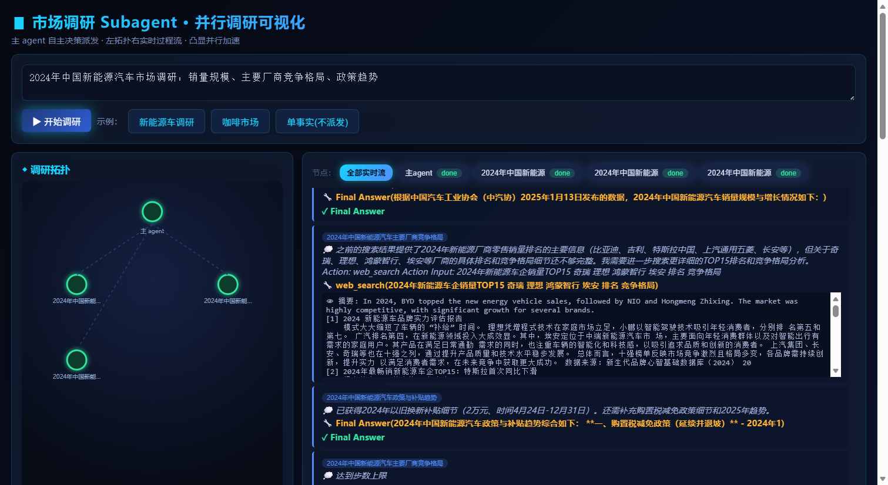

# 市场调研 Subagent 并行调研系统

用户提一个市场调研问题，主 agent 自主决定是否派发多个 subagent 并行联网收集不同侧面的资料，聚合成结构化调研报告。直接落地「subagent 并行」范式（动态 Orchestrator-Workers 拓扑），并用真实数据量化并行加速优势。

## 核心特性

- **LLM 自主路由**：主 agent 是 ReAct 循环，持有 `web_search`（单一事实直接搜）和 `dispatch_subagents`（多侧面问题派发并行调研）两个工具，根据 query 自行决定用哪个——不是固定拓扑
- **subagent 真并行**：`ThreadPoolExecutor` 并行执行 N 个 subagent，wall-clock ≈ max(单 agent 时长) 而非 sum，实测 dispatch 加速 **2.51×**
- **全程 ReAct trace 捕获**：每个 agent 的 Thought/Action/Observation 逐步记录，供可视化与审计
- **实时可视化**：FastAPI + SSE 逐事件推送，左侧拓扑图随派发生长、节点实时脉冲，右侧点任意节点看其 ReAct 过程
- **A/B 与 Benchmark**：`eval_compare.py` 做 parallel vs serial 对比；`benchmark.py` 支持冻结搜索快照 + JSON judge 的可恢复评测

## 界面预览



左侧拓扑图：主 agent 节点 + 派发时动态加入的 subagent 节点，运行中脉冲高亮、完成变绿；右侧过程流：所有节点的 ReAct 步骤（Thought/Action/Observation）实时滚动，点节点可切换只看该 agent 的轨迹。

## 快速开始

### 1. 安装依赖

```bash
pip install -r requirements.txt
```

仅 `openai` + `fastapi` + `uvicorn`，Tavily 用标准库 `urllib` 调用，ReAct 引擎与拓扑可视化全部手写，零重型框架。

### 2. 配置 API Key

复制 `.env.example` 为 `.env`，填入真实密钥：

```dotenv
DEEPSEEK_API_KEY=sk-xxx
TAVILY_API_KEY=tvly-xxx
```

启动时自动读取根目录 `.env`，无需手动 export。

### 3. 启动 Web 服务（主入口）

```bash
uvicorn src.serve:app --host 0.0.0.0 --port 8002
# 浏览器打开 http://localhost:8002
```

- `GET /health` → Tavily / LLM 密钥就绪状态
- `POST /query {question}` → SSE 事件流：`start` → `main_step` → `dispatch` → `subagent_step` → `subagent_done` → `final` → `done`

### 4. CLI 直接跑一次调研

```bash
python src/agents.py
```

## 使用方式

### 作为模块调用

```python
import sys; sys.path.insert(0, "src")
from agents import run_research

r = run_research("2024年中国新能源汽车市场调研：销量规模、主要厂商竞争格局、政策趋势")
print(r["final_answer"])
print("并行统计:", r["parallel_stats"])
```

带回调（接 SSE / 日志 / 自定义可视化）：

```python
r = run_research("中国咖啡市场调研：规模、品牌、趋势",
    on_main_step=lambda s: print(f"[main] {s['action']}"),
    on_subagent_step=lambda sid, s: print(f"[{sid}] {s['action']}"),
    on_dispatch=lambda i: print(f"派发: {i['subtopics']}"),
    on_subagent_done=lambda sid, d, t: print(f"[{sid}] done {d}s"))
```

### Parallel vs Serial A/B 对比

```bash
python src/eval_compare.py --limit 2
```

每题分别以并行（ThreadPool）和串行（for 循环）跑一遍，输出墙钟/加速对比表到 `outputs/eval_compare.json`。

### Benchmark 评测

```bash
python src/benchmark.py   # 数据集在 data/benchmark_50.json
```

## 整体流水线

```
用户问题
   ↓
主 agent ReAct 循环（工具: web_search + dispatch_subagents）
   ├─ 简单事实 → 直接 web_search → Final Answer
   └─ 多侧面调研 → dispatch_subagents("课题1|课题2|课题3")
                       ↓
              ┌─ subagent1 ReAct(web_search) ─┐
              ├─ subagent2 ReAct(web_search) ─┤ 并行(ThreadPool)
              └─ subagent3 ReAct(web_search) ─┘
                       ↓ 汇总（含并行加速统计）
              主 agent 综合成报告 → Final Answer
```

## 项目结构

```
market_research_subagents/
├── src/
│   ├── serve.py              # 主入口：FastAPI + SSE 流式服务
│   ├── agents.py             # 主 agent + dispatch_subagents 并行派发
│   ├── react_loop.py         # 通用 ReAct 引擎（主/subagent 共用）
│   ├── tavily_search.py      # Tavily 搜索（urllib 零依赖）
│   ├── search_processing.py  # 搜索结果清洗与查询感知窗口选择
│   ├── llm_client.py         # 极简 DeepSeek 客户端（OpenAI 兼容接口）
│   ├── config.py             # 读取根目录 .env
│   ├── eval_compare.py       # parallel vs serial A/B 对比
│   ├── benchmark.py          # 可恢复 benchmark（冻结快照 + JSON judge）
│   └── benchmark_dataset.py  # benchmark 任务集定义
├── static/
│   ├── index.html            # 主流程 UI（左拓扑右 trace）
│   └── viz/topology.js       # SVG 拓扑动画（独立可视化模块）
├── data/
│   └── benchmark_50.json     # 50 题 benchmark 数据集
├── docs/
│   └── screenshot.png        # 前端运行截图
├── outputs/                  # 运行产物（已 gitignore）
├── .env.example              # 密钥模板
└── requirements.txt
```

## 实验结果（真实跑出）

| 问题 | 并行墙钟 | 串行墙钟 | dispatch 加速 |
|------|---------|---------|--------------|
| 新能源汽车调研 | 35.88s | 44.78s | 2.32× |
| 咖啡市场调研 | 30.07s | 56.16s | 2.71× |
| **平均** | **32.98s** | **50.47s** | **2.51×** |

总墙钟加速（1.4×）小于 dispatch 加速（2.51×）：主 agent 自身的规划/综合是串行段，不可并行化（Amdahl 定律）。